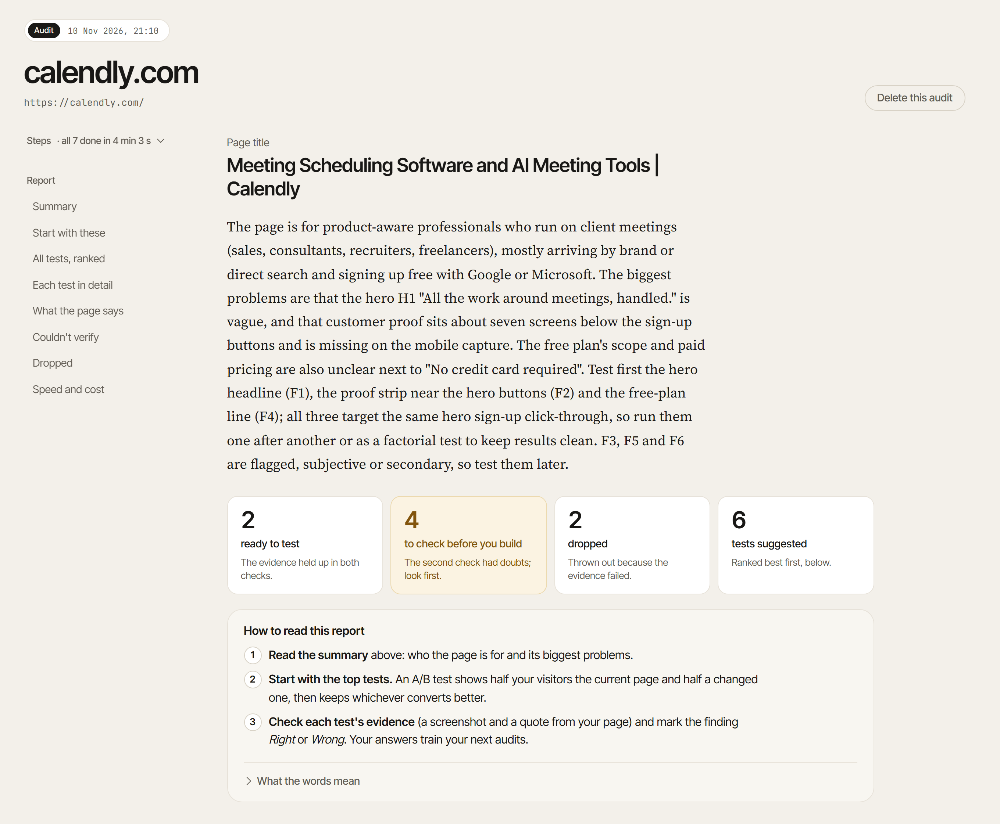
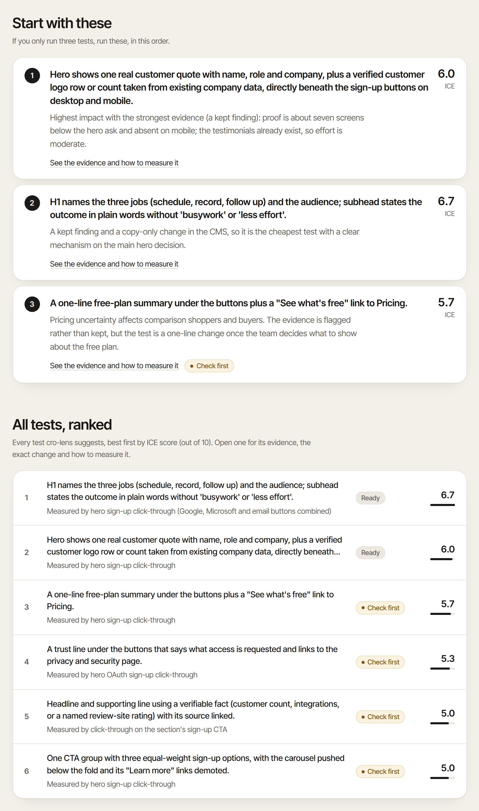
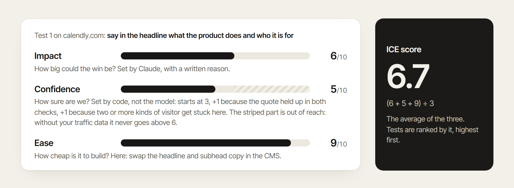
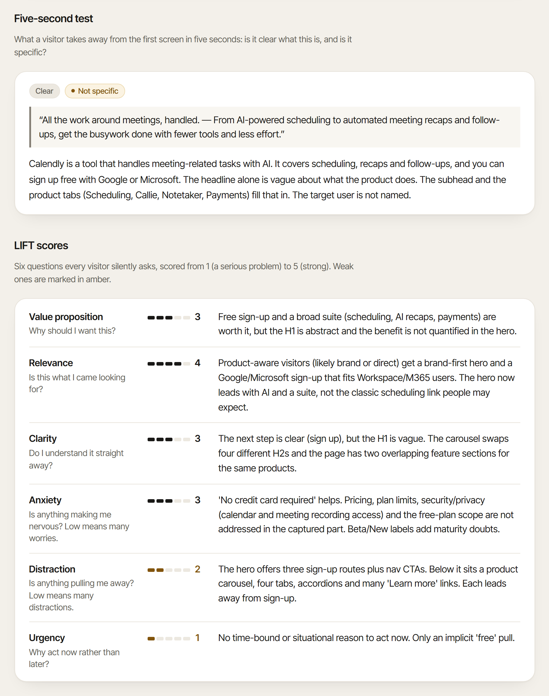
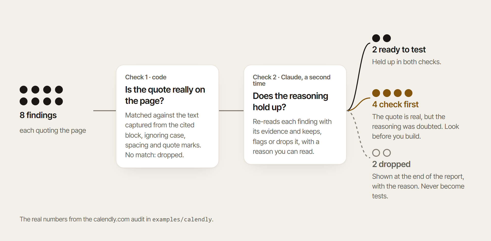
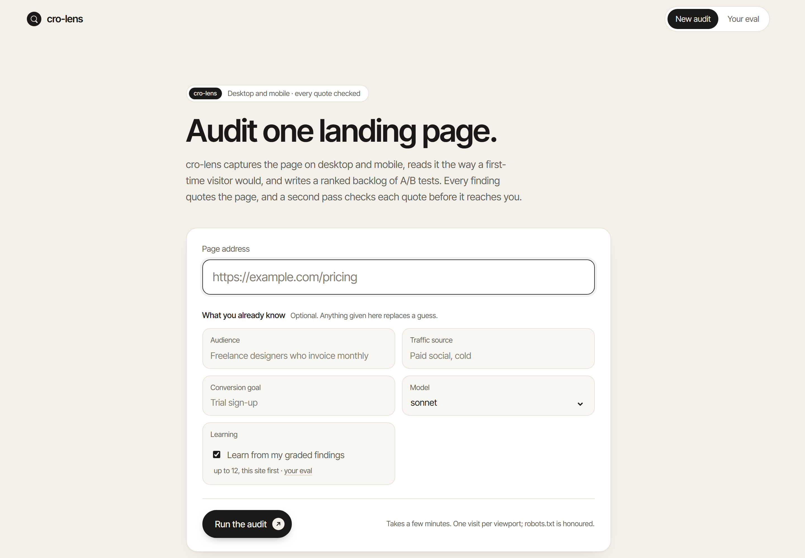
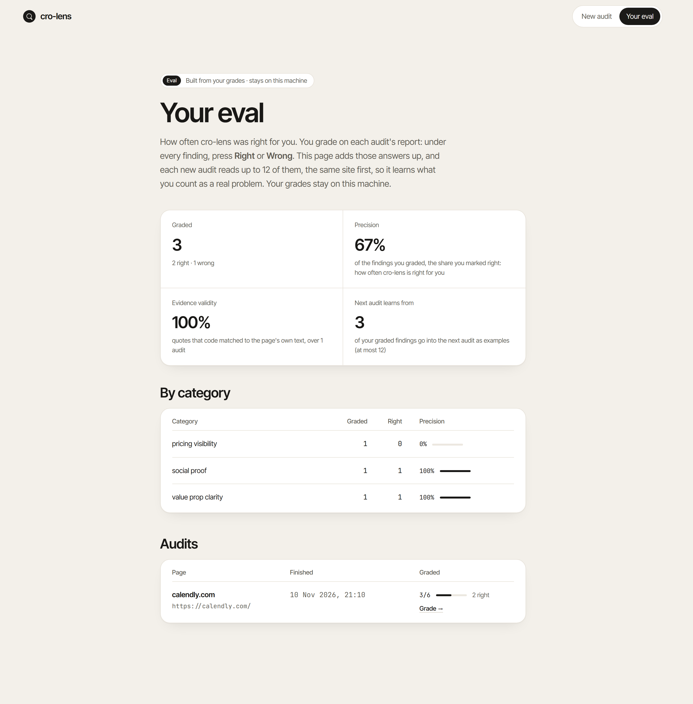
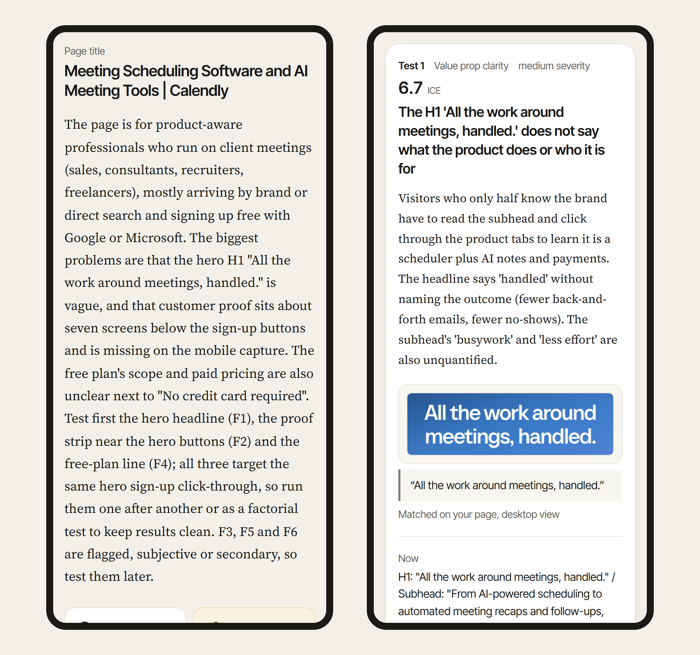

<p align="center">
  
</p>

<h1 align="center">cro-lens</h1>

<p align="center">
  <b>Landing page teardowns that quote the page.</b><br>
  One URL in. A ranked, self-checked list of A/B tests out, on your own Claude Code login.
</p>

<p align="center">
  <a href="https://github.com/brkakyldz/cro-lens/actions/workflows/ci.yml"></a>
  
  
  <a href="LICENSE"></a>
</p>

<p align="center">
  <a href="#what-it-does">What it does</a> ·
  <a href="#quick-start">Quick start</a> ·
  <a href="#reading-the-report">Reading the report</a> ·
  <a href="#why-you-can-check-it">Why you can check it</a> ·
  <a href="#the-web-app">Web app</a> ·
  <a href="#grading-and-your-eval">Grading</a> ·
  <a href="#signing-in">Signing in</a>
</p>

<br>

<p align="center">
  
</p>

<p align="center"><sub>The top of a real report, for calendly.com. The full report is in <a href="examples/calendly/report.md"><code>examples/calendly</code></a>.</sub></p>

## What it does

A landing page exists to get visitors to do one thing: sign up, start a trial,
buy. A visitor who does it is a **conversion**, and raising the share who do is
**conversion rate optimisation** (CRO). The usual way to improve a page is an
**A/B test**: show half your visitors the current page and half a changed one,
then keep whichever converts better. The hard part is knowing what to test.

cro-lens tells you, for one public page, and shows you the proof for each idea.

<p align="center">
  
</p>

Only the browser step touches the page, once per viewport, and it honours
robots.txt. Everything Claude does goes through your own `claude` CLI login.

## Quick start

You need **Python 3.12+**, [uv](https://docs.astral.sh/uv/) and
[Claude Code](https://docs.claude.com/en/docs/claude-code), signed in with
`claude auth login`. No API key is needed.

```bash
git clone https://github.com/brkakyldz/cro-lens.git
cd cro-lens
uv sync
uv run playwright install chromium
uv run cro-lens ui
```

Open <http://127.0.0.1:8765>, paste a page address and press **Run the audit**.
An audit takes a few minutes. Prefer the terminal? `uv run cro-lens <url>`
prints a line per step and writes the same report:

```text
✓ robots       robots.txt allows this path (0.4s)
✓ capture      desktop 242 blocks · mobile 238 blocks (95.4s)
✓ understand   audience: Individual professionals and small-to-mid teams whose work runs on meetings (medium) (43.5s)
✓ analyse      8 findings (67.6s)
✓ check        kept 2 · flagged 4 · dropped 2 (15.1s)
✓ hypotheses   6 experiments (26.6s)
✓ report       report.md · report.json
report: ~/.cro-lens/runs/20261110-210614-calendly-com/report.md
cost: $0.410 API-equivalent (4 model calls)
```

- **Tell it what you know.** The start page (or `--audience`, `--traffic`,
  `--goal`) takes the audience, the traffic source and the conversion goal.
  What you give replaces the model's guess and shows as *Given by you*.
- **The cost line** is what the calls would cost at API list prices. On a
  Claude subscription you are not billed per call, so it is an
  *API-equivalent*, not a charge. With `ANTHROPIC_API_KEY` set, the calls are
  billed to that API account and cro-lens says so ([Signing in](#signing-in)).
- **A stopped audit continues.** After a model error, a sign-out or Ctrl-C,
  press **Continue** (or run `uv run cro-lens resume <run_id>`). It picks up at
  the step that did not finish, without visiting the page again.

## Reading the report

The report reads top to bottom. It is also saved as `report.md` and
`report.json` in the run folder.

### 1. The summary and four counts

Who the page is for, its biggest problems, and what to test first. Then:

| Count | Meaning |
| --- | --- |
| ready to test | The evidence held up in both checks. |
| to check before you build | The quote is on the page, but the second check had doubts. |
| dropped | Thrown out because the evidence failed. |
| tests suggested | A/B tests, ranked best first. |

### 2. The tests, ranked

**Start with these** names the three tests to run first, each with the reason
it was picked. The pick weighs impact, effort and how strong the evidence is,
so the order can differ from the score. **All tests, ranked** lists every test,
best first, marked *Ready* or *Check first*.

<p align="center">
  
</p>

Tests are ranked by their **ICE score**: the average of Impact, Confidence and
Ease. This is how calendly's first test got its 6.7:

<p align="center">
  
</p>

### 3. Each test in detail

One card per finding, in the same order as the list:

<p align="center">
  
</p>

1. **The problem**, its category and severity, and why it costs conversions.
2. **The proof**: a crop of the screenshot and the quote it came from. *Matched
   on your page* means code found that text in the captured page.
3. **The change**: what the page says **now**, what to **test** instead, and
   suggested **wording**. Fill in anything in [brackets] with your own facts.
4. **How to measure it**: the number that should go up; the **guardrail**, a
   number that must not get worse (more clicks are no win if the leads get
   worse); and whether an A/B test can settle it at your traffic at all.
5. **Folded detail**: the bet behind the test, how each ICE number was set,
   more quotes, and which kinds of visitor get stuck here.
6. **Your verdict**: *Right* or *Wrong*, with an optional note. See
   [Grading](#grading-and-your-eval).

A card marked **Check first** carries an amber note: the quote is real, but
the second check doubted the reasoning, and the note says why. It is not
wrong; look before you spend on it.

### 4. What the page says, and to whom

How cro-lens read the page: the **audience**, the **job to be done** (what the
visitor came to get done), the likely **traffic source**, the **awareness**
level (from *unaware* of the problem to *most aware*, ready to act), the
**promise** and the **offer**. Each is a guess with its confidence, or *Given
by you*. Every test rests on this reading; if it is wrong, run again and fill
in what you know.

<p align="center">
  
</p>

- **Five-second test**: what a visitor takes from the first screen in five
  seconds. Is it *clear* what this is, and is it *specific*?
- **LIFT scores**: six questions every visitor silently asks, scored 1 (a
  serious problem) to 5 (strong). Weak ones are marked in amber.
- **Persona walks** (folded): five simulated visitors (a sceptical
  first-timer, a comparison shopper, someone ready to buy, a mobile skimmer, a
  risk-averse evaluator), where each gets stuck, and whether the page answers
  the questions they arrive with.

### 5. The fine print

- **Assumptions and what we couldn't verify**: what cro-lens could not see and
  assumed instead, such as what happens after the click.
- **Dropped by the self-check**: findings thrown out, each with the reason.
- **Page speed**: when the main content appeared, the server's first answer,
  layout jumping and download size, from one visit from your machine. A rough
  signal, not what real visitors see.
- **Run and cost**: the cost, the model calls, how many of your grades the run
  learned from, and links to the report files and the full screenshot.

### Glossary

| Word | Meaning |
| --- | --- |
| Conversion | The one thing the page wants a visitor to do, such as clicking "Get your free plan". |
| A/B test | Half your visitors see the current page, half a changed one; you keep whichever converts better. |
| ICE score | Impact, Confidence and Ease averaged. Higher is better. |
| Check first | The quote is real, but the second check doubted the reasoning. Look before you build. |
| Guardrail | A number that must not get worse while you test. |
| LIFT | A common way to score a landing page on six questions a visitor asks. |
| Persona | A simulated kind of visitor, used to see where different people get stuck. |

## Why you can check it

A model can write a confident finding about text that is not on the page.
cro-lens does not let one through unchecked:

<p align="center">
  
</p>

- Every finding must cite a block of the page and quote it. **Code** checks
  the quote against that block's captured text before any model sees the
  finding again.
- **A second Claude pass** then re-reads each finding with its evidence and
  keeps, flags or drops it, with a reason you can read.
- **Confidence is computed by code**, not chosen by the model, and stays at 6
  or below because cro-lens never sees your traffic data.
- Nothing is hidden: dropped findings and every assumption are listed in the
  report.

## The web app

Start an audit, watch each step run, read and grade the report, continue a
stopped audit, delete old ones and see your eval.

<table>
  <tr>
    <td width="50%"></td>
    <td width="50%"></td>
  </tr>
  <tr>
    <td align="center"><sub><b>New audit.</b> Only the address is required.</sub></td>
    <td align="center"><sub><b>Your eval.</b> Built from your own grades.</sub></td>
  </tr>
</table>

<p align="center">
  
</p>

<p align="center"><sub>The report on a phone.</sub></p>

## Grading and your eval

Only you can say whether a finding is right for your page. Under every finding
are **Right** and **Wrong** buttons and a note field. Your grades:

- **Measure the tool for you.** *Your eval* (in the web app, or
  `cro-lens eval`) shows how many findings you graded, your **precision** (the
  share you marked right, overall and per category) and **evidence validity**
  (the share of quotes that code matched to the page, over all your audits). A
  number with nothing behind it reads *pending*, never 0.
- **Teach your next audits.** A new audit shows the model up to 12 of your
  graded findings, same site first, then the newest, so it leans toward the
  kinds you marked right and away from those you marked wrong. This steers by
  example and does not retrain the model, so a few grades teach little. Untick
  *Learn from my graded findings*, or pass `--no-feedback`, to leave them out.

Grades are stored only on your machine, in `~/.cro-lens/grades.json`. They
reach Claude only as examples in your own audits, and they stay when you delete
the audit they came from.

## Commands

| Command | What it does |
| --- | --- |
| `cro-lens ui [--port 8765]` | Open the local web app. |
| `cro-lens <url>` or `cro-lens analyze <url>` | Audit one page. Options: `--model sonnet\|opus`, `--audience`, `--traffic`, `--goal`, `--out DIR`, `--no-feedback`. |
| `cro-lens resume <run_id\|DIR>` | Continue a stopped audit from the step that did not finish. |
| `cro-lens eval` | Print your eval. |

Run them with `uv run` in the cloned folder. Audits are kept in
`~/.cro-lens/runs/` and grades in `~/.cro-lens/grades.json`; set
`CRO_LENS_HOME` to move both. `--model opus` uses a larger model and takes
longer; the default is Sonnet.

## Signing in

cro-lens has no account of its own and never sees a password or token. Every
model call goes through your `claude` CLI, which picks the credential. The
first one set wins:

| Credential | How you set it | Who pays | Use it when |
|---|---|---|---|
| `ANTHROPIC_API_KEY` | an Anthropic Console API key in the environment | **the API account, per call** | you have no Claude subscription |
| `CLAUDE_CODE_OAUTH_TOKEN` | `claude setup-token`, then the value in the environment; it expires and does not renew | your subscription | a server or CI with no browser |
| `claude auth login` | run it once; it renews itself | your subscription | **everything else** |

Before visiting the page, cro-lens tests a token or key with one tiny call:

- **Token rejected, login works:** the audit runs on your login, with a warning
  to remove or renew the token.
- **Token rejected, no login:** the audit doesn't start; the message names the
  variable.
- **API key set:** the audit is billed to that API account, and cro-lens says
  so before it starts. A rejected key stops the audit; it never switches you to
  the subscription on its own.

To see the active credential, run `claude auth status --json` and read
`authMethod`: `claude.ai` is the login, `oauth_token` the token, `api_key` the
key.

<details>
<summary><b>Remove a token or key so that <code>claude auth login</code> is used</b></summary>

<br>

```text
# Windows (PowerShell): removes it for your user; open a new terminal afterwards
[Environment]::SetEnvironmentVariable('CLAUDE_CODE_OAUTH_TOKEN', $null, 'User')
# macOS / Linux: delete the export line from ~/.zshrc or ~/.bashrc, then
unset CLAUDE_CODE_OAUTH_TOKEN
```

Use `ANTHROPIC_API_KEY` in place of the name for an API key, then restart
`cro-lens ui` from a new terminal. A run that stopped at a sign-in error
continues with `cro-lens resume <run_id>` or the **Continue** button.

</details>

## Privacy, conduct and limits

- **Polite.** One visit per viewport per audit, robots.txt honoured. Pages
  behind a bot challenge or a login wall are refused, never bypassed.
- **Local.** The only model traffic is what your `claude` CLI sends with your
  own credential. The web app listens on `127.0.0.1` only; audits and grades
  are stored only on your machine.
- **Limits.** One page, not a funnel: what happens after the click is listed
  as an assumption. A claim about a pure visual (an image, colour contrast)
  must quote nearby text. Where you run it from, cookie consent and the site's
  own A/B tests can change the page the audit sees.

## Contributing

Issues and pull requests are welcome; start with [CONTRIBUTING.md](CONTRIBUTING.md).

## License

[MIT](LICENSE). Third-party notices, including the bundled fonts, are in
[NOTICE](NOTICE).
