# Landing page teardown — Allbirds: Comfortable, Sustainable Shoes & Apparel

`https://www.allbirds.com/` · 2026-11-10 · model `sonnet`

## Summary

This page is for US shoppers, mostly brand-aware, who arrive for the Allbirds Black Friday sale and want a discounted men's or women's pair or a gift. The biggest problem, confirmed by screenshots, is the "Where are we shipping to?" modal, which covers the hero and its CTAs before the offer is seen. Next, the sale promise is not carried through. The hero buttons are generic, and the "FINAL SALE" badges have no stated returns terms. Test the modal removal first, with the sale-specific hero buttons (F6) and the returns/final-sale clarity (F4) next. Treat the performance (F2), reviews (F3) and other flagged findings as lower-confidence until field data or a check of the live page confirms them.

## Top 3 experiments

### 1. The 'Where are we shipping to?' modal blocks the hero and its CTAs on first load, on desktop and mobile

*Why first:* The modal blocks the hero and CTAs for nearly every visitor, and a screenshot check confirmed it. Fixing it affects the whole page, and the dev change is moderate.

**X2 · ICE 6.67** (I 9 · C 6 · E 5)  
If we change the blocking "Where are we shipping to?" modal (with its CONFIRM button) to a non-blocking slim top bar that preselects United States and only asks visitors detected outside the US to switch, then hero CTA click-through will increase for first-time and mobile visitors arriving for the Black Friday sale, because the modal covers the hero headline and the Shop Men/Shop Women buttons on both viewports and United States is already the default for most of them.  
Change: *Full modal on first load: "Where are we shipping to?" / "Purchasing from your country's website is the best way to connect your feet to the world's most comfortable shoe." / CONFIRM* → *No modal for visitors geolocated to the US; a one-line dismissible bar under the sale banner. Non-US visitors still get the modal.*  
Suggested copy: “Shipping to United States. Change country”  
Primary metric: hero CTA click-through (Shop Men / Shop Women) · guardrail: wrong-country orders / checkout country-mismatch rate · feasibility: `ab_ok`  
Why these scores — impact: The modal hides the offer and the CTAs for nearly every visitor on first load, so it gates conversion for the main persona.; confidence: base 3; +1 evidence verified and kept by self-check; +1 matches weak LIFT factor (clarity, distraction); +1 raised for 2+ personas; capped at 6: no traffic data; ease: Needs a dev change to geo-detection and the modal logic, but no new content.

### 2. Hero and tile CTAs are split into repeated SHOP MEN / SHOP WOMEN pairs, and none leads directly to the sale

*Why first:* A button label and link change in the CMS that connects the 70% sale promise to sale pages. It is the cheapest test with a clear primary metric.

**X1 · ICE 7.0** (I 7 · C 5 · E 9) ⚑ flagged by self-check  
If we change the hero buttons "SHOP MEN" and "SHOP WOMEN" to "SHOP MEN'S SALE" and "SHOP WOMEN'S SALE" linking straight to the discounted collections, then hero CTA click-through to sale pages will increase for ready-to-buy and mobile visitors, because the hero promises up to 70% off but its buttons are generic and the sale links only exist in the menu panel.  
Change: *Hero buttons "SHOP MEN" / "SHOP WOMEN" (the same pair repeats in later tiles)* → *Hero buttons labelled and linked to the sale collections; later tiles keep the generic pair.*  
Suggested copy: “SHOP MEN'S SALE | SHOP WOMEN'S SALE”  
Primary metric: hero CTA click-through to sale collection pages · guardrail: revenue per session (to avoid sending people to thinner sale ranges) · feasibility: `ab_ok`  
Why these scores — impact: Shortens the path from the sale promise to discounted products for the main buyer.; confidence: base 3; +1 matches weak LIFT factor (clarity); +1 raised for 2+ personas; capped at 6: no traffic data; ease: Button text and link change in the CMS.

### 3. 'FINAL SALE' badges appear on sale products with no explanation of the returns policy, and returns are only a footer link

*Why first:* The "FINAL SALE" badge and footer-only returns link were verified. Fit risk on shoes is a real blocker, and the fix is mostly copy once the policy is confirmed.

**X3 · ICE 6.67** (I 7 · C 6 · E 7)  
If we change the bare "FINAL SALE" badges (with returns only in the footer link "Returns/Exchanges") to a badge with a short tooltip plus a returns line under the hero and Best Sellers heading, then product-click and add-to-cart rate will increase for risk-averse and ready-to-buy shoppers, because shoes depend on fit and "FINAL SALE" signals no returns without saying what it means.  
Change: *"FINAL SALE" badge on cards; returns only in the footer link "Returns/Exchanges"* → *Badge with tooltip explaining the terms, and a returns reassurance line above the product grid. Use the real policy only.*  
Suggested copy: “Final sale: this style can't be returned or exchanged. All other styles: free returns within [X] days. See full policy.”  
Primary metric: add-to-cart rate on sale product cards · guardrail: return rate / customer-service contacts about returns · feasibility: `ab_ok`  
Why these scores — impact: Fit risk on shoes is a real purchase blocker for the main buyer, and clearer terms help sale-price buyers.; confidence: base 3; +1 evidence verified and kept by self-check; +1 matches weak LIFT factor (anxiety); +1 raised for 2+ personas; capped at 6: no traffic data; ease: Copy plus a small tooltip and a line in the layout; the policy facts must be confirmed with the business.

## Experiment backlog

| # | Hypothesis | Metric | I | C | E | ICE | Feasibility | Flag |
|---|---|---|---|---|---|---|---|---|
| X1 | If we change the hero buttons "SHOP MEN" and "SHOP WOMEN" to "SHOP MEN'S SALE" and "SHOP WOMEN'S SALE" linking straight to the discounted collections, then hero CTA click-through to sale pages will increase for ready-to-buy and mobile visitors, because the hero promises up to 70% off but its buttons are generic and the sale links only exist in the menu panel. | hero CTA click-through to sale collection pages | 7 | 5 | 9 | **7.0** | ab_ok | ⚑ |
| X2 | If we change the blocking "Where are we shipping to?" modal (with its CONFIRM button) to a non-blocking slim top bar that preselects United States and only asks visitors detected outside the US to switch, then hero CTA click-through will increase for first-time and mobile visitors arriving for the Black Friday sale, because the modal covers the hero headline and the Shop Men/Shop Women buttons on both viewports and United States is already the default for most of them. | hero CTA click-through (Shop Men / Shop Women) | 9 | 6 | 5 | **6.67** | ab_ok |  |
| X3 | If we change the bare "FINAL SALE" badges (with returns only in the footer link "Returns/Exchanges") to a badge with a short tooltip plus a returns line under the hero and Best Sellers heading, then product-click and add-to-cart rate will increase for risk-averse and ready-to-buy shoppers, because shoes depend on fit and "FINAL SALE" signals no returns without saying what it means. | add-to-cart rate on sale product cards | 7 | 6 | 7 | **6.67** | ab_ok |  |
| X4 | If we change the H1 "Our biggest sale. Your comfiest season." and the small kicker "EARLY ACCESS · UP TO 70% OFF" to an H1 that leads with the discount and names the product, then hero CTA click-through will increase for first-time and comparison shoppers, because today the 70% claim sits in a small line above a slogan that names no product and is qualified by "select styles". | hero CTA click-through | 6 | 5 | 9 | **6.67** | ab_ok | ⚑ |
| X5 | If we change the product cards and hero (name, colour and price only) to show a star rating with review count and a one-line review quote beneath the hero, then add-to-cart or product-click rate will increase for first-time and comparison shoppers, because the page claims "the world's most comfortable shoe" with no ratings or testimonials to back it up. | product card click-through rate | 7 | 5 | 5 | **5.67** | ab_ok | ⚑ |
| X6 | If we change the Best Sellers heading (cards mostly at full price or 30% off, e.g. "$73.50 $105") to a section that leads with the deepest-discount styles and a visible percent-off badge, then product-click rate will increase for comparison shoppers and ready-to-buy visitors, because the visible discounts don't match the "UP TO 70% OFF" hero promise and no copy says which styles reach 70%. | product card click-through rate | 6 | 4 | 6 | **5.33** | ab_ok | ⚑ |
| X7 | If we change the banner "Black Friday Early Access. Up to 70% off select styles." to include an end date, then hero CTA click-through will increase for ready-to-buy and comparison shoppers, because with no deadline in the banner or hero they can postpone the decision. | hero CTA click-through | 3 | 4 | 9 | **5.33** | bold_change_only | ⚑ |
| X8 | If we change the three generic paragraphs near the footer ("Lightweight, bouncy, and wildly comfortable", "better for the planet—win, win, win") to a product-specific comfort block placed below the hero, then product-click rate will increase for comparison shoppers and first-timers, because the only explanatory copy sits next to the footer and gives no figures or materials to weigh against rivals. | product card click-through rate | 4 | 5 | 7 | **5.33** | qualitative_only | ⚑ |
| X9 | If we change the mobile hero's loading path (519 requests, lab LCP about 24.6 s) to a lean path with a preloaded, compressed hero image and third-party scripts deferred until after first paint, then mobile bounce rate will decrease for mobile skimmers, because one emulated visit showed the largest element rendering very late and the hero is the first impression. | mobile bounce rate | 6 | 5 | 3 | **4.67** | bold_change_only | ⚑ |

Confidence is computed, not guessed: base 3, +1 evidence kept by the self-check, +1 matches a weak LIFT factor, +1 raised by two or more personas; capped at 6 because the tool has no traffic data.

**X1 · ICE 7.0** (I 7 · C 5 · E 9) ⚑ flagged by self-check  
If we change the hero buttons "SHOP MEN" and "SHOP WOMEN" to "SHOP MEN'S SALE" and "SHOP WOMEN'S SALE" linking straight to the discounted collections, then hero CTA click-through to sale pages will increase for ready-to-buy and mobile visitors, because the hero promises up to 70% off but its buttons are generic and the sale links only exist in the menu panel.  
Finding F6: Hero and tile CTAs are split into repeated SHOP MEN / SHOP WOMEN pairs, and none leads directly to the sale  
Change: *Hero buttons "SHOP MEN" / "SHOP WOMEN" (the same pair repeats in later tiles)* → *Hero buttons labelled and linked to the sale collections; later tiles keep the generic pair.*  
Suggested copy: “SHOP MEN'S SALE | SHOP WOMEN'S SALE”  
Primary metric: hero CTA click-through to sale collection pages · guardrail: revenue per session (to avoid sending people to thinner sale ranges) · feasibility: `ab_ok`  
Why these scores — impact: Shortens the path from the sale promise to discounted products for the main buyer.; confidence: base 3; +1 matches weak LIFT factor (clarity); +1 raised for 2+ personas; capped at 6: no traffic data; ease: Button text and link change in the CMS.

**X2 · ICE 6.67** (I 9 · C 6 · E 5)  
If we change the blocking "Where are we shipping to?" modal (with its CONFIRM button) to a non-blocking slim top bar that preselects United States and only asks visitors detected outside the US to switch, then hero CTA click-through will increase for first-time and mobile visitors arriving for the Black Friday sale, because the modal covers the hero headline and the Shop Men/Shop Women buttons on both viewports and United States is already the default for most of them.  
Finding F1: The 'Where are we shipping to?' modal blocks the hero and its CTAs on first load, on desktop and mobile  
Change: *Full modal on first load: "Where are we shipping to?" / "Purchasing from your country's website is the best way to connect your feet to the world's most comfortable shoe." / CONFIRM* → *No modal for visitors geolocated to the US; a one-line dismissible bar under the sale banner. Non-US visitors still get the modal.*  
Suggested copy: “Shipping to United States. Change country”  
Primary metric: hero CTA click-through (Shop Men / Shop Women) · guardrail: wrong-country orders / checkout country-mismatch rate · feasibility: `ab_ok`  
Why these scores — impact: The modal hides the offer and the CTAs for nearly every visitor on first load, so it gates conversion for the main persona.; confidence: base 3; +1 evidence verified and kept by self-check; +1 matches weak LIFT factor (clarity, distraction); +1 raised for 2+ personas; capped at 6: no traffic data; ease: Needs a dev change to geo-detection and the modal logic, but no new content.

**X3 · ICE 6.67** (I 7 · C 6 · E 7)  
If we change the bare "FINAL SALE" badges (with returns only in the footer link "Returns/Exchanges") to a badge with a short tooltip plus a returns line under the hero and Best Sellers heading, then product-click and add-to-cart rate will increase for risk-averse and ready-to-buy shoppers, because shoes depend on fit and "FINAL SALE" signals no returns without saying what it means.  
Finding F4: 'FINAL SALE' badges appear on sale products with no explanation of the returns policy, and returns are only a footer link  
Change: *"FINAL SALE" badge on cards; returns only in the footer link "Returns/Exchanges"* → *Badge with tooltip explaining the terms, and a returns reassurance line above the product grid. Use the real policy only.*  
Suggested copy: “Final sale: this style can't be returned or exchanged. All other styles: free returns within [X] days. See full policy.”  
Primary metric: add-to-cart rate on sale product cards · guardrail: return rate / customer-service contacts about returns · feasibility: `ab_ok`  
Why these scores — impact: Fit risk on shoes is a real purchase blocker for the main buyer, and clearer terms help sale-price buyers.; confidence: base 3; +1 evidence verified and kept by self-check; +1 matches weak LIFT factor (anxiety); +1 raised for 2+ personas; capped at 6: no traffic data; ease: Copy plus a small tooltip and a line in the layout; the policy facts must be confirmed with the business.

**X4 · ICE 6.67** (I 6 · C 5 · E 9) ⚑ flagged by self-check  
If we change the H1 "Our biggest sale. Your comfiest season." and the small kicker "EARLY ACCESS · UP TO 70% OFF" to an H1 that leads with the discount and names the product, then hero CTA click-through will increase for first-time and comparison shoppers, because today the 70% claim sits in a small line above a slogan that names no product and is qualified by "select styles".  
Finding F5: The H1 'Our biggest sale. Your comfiest season.' is a slogan that names no product or benefit, and the 70% claim is in a small kicker qualified by 'select styles'  
Change: *Kicker "EARLY ACCESS · UP TO 70% OFF" above H1 "Our biggest sale. Your comfiest season."* → *Large H1 with the discount and the product; kicker keeps the early-access cue.*  
Suggested copy: “Up to 70% off the world's most comfortable shoes. Early access to our biggest sale.”  
Primary metric: hero CTA click-through · guardrail: bounce rate · feasibility: `ab_ok`  
Why these scores — impact: Makes the offer and product clear in the first seconds, though the hero is already readable for sale-aware visitors.; confidence: base 3; +1 matches weak LIFT factor (clarity); +1 raised for 2+ personas; capped at 6: no traffic data; ease: Headline text change in the CMS.

**X5 · ICE 5.67** (I 7 · C 5 · E 5) ⚑ flagged by self-check  
If we change the product cards and hero (name, colour and price only) to show a star rating with review count and a one-line review quote beneath the hero, then add-to-cart or product-click rate will increase for first-time and comparison shoppers, because the page claims "the world's most comfortable shoe" with no ratings or testimonials to back it up.  
Finding F3: No customer reviews, ratings or press proof appear next to the product cards or hero  
Change: *Cards show only name, colour and price; the claim "the world's most comfortable shoe" has no proof beside it* → *Star rating and review count on each Best Seller card, plus a proof strip under the hero with an aggregate rating and one customer quote*  
Suggested copy: “Rated [X.X]/5 by [N] verified shoppers. "Honestly the comfiest shoes I own." (replace with a real, verified review)”  
Primary metric: product card click-through rate · guardrail: page load time (review widget weight) · feasibility: `ab_ok`  
Why these scores — impact: Removes the main doubt for visitors who don't know the brand. The finding is flagged because reviews may exist in widgets not seen.; confidence: base 3; +1 matches weak LIFT factor (anxiety); +1 raised for 2+ personas; capped at 6: no traffic data; ease: Needs a review data feed or widget and new design; real review data must exist (check that reviews are not already present).

**X6 · ICE 5.33** (I 6 · C 4 · E 6) ⚑ flagged by self-check  
If we change the Best Sellers heading (cards mostly at full price or 30% off, e.g. "$73.50 $105") to a section that leads with the deepest-discount styles and a visible percent-off badge, then product-click rate will increase for comparison shoppers and ready-to-buy visitors, because the visible discounts don't match the "UP TO 70% OFF" hero promise and no copy says which styles reach 70%.  
Finding F7: Best Sellers shows mostly full-price items and 30% discounts, which undercuts the 'up to 70% off' hero promise  
Change: *Best Sellers grid with mixed full-price and 30%-off cards and no discount badges* → *A "Biggest savings" row first, with a percent-off badge on every discounted card*  
Suggested copy: “Biggest savings: up to 70% off”  
Primary metric: product card click-through rate · guardrail: average order value · feasibility: `ab_ok`  
Why these scores — impact: Aligns what shoppers see with what the hero promises. The finding is flagged because deep discounts may sit elsewhere.; confidence: base 3; +1 raised for 2+ personas; capped at 6: no traffic data; ease: Merchandising and layout change; need to know which styles carry the deepest cuts.

**X7 · ICE 5.33** (I 3 · C 4 · E 9) ⚑ flagged by self-check  
If we change the banner "Black Friday Early Access. Up to 70% off select styles." to include an end date, then hero CTA click-through will increase for ready-to-buy and comparison shoppers, because with no deadline in the banner or hero they can postpone the decision.  
Finding F8: The 'Early Access' sale has no end date or deadline in the banner or hero  
Change: *"Black Friday Early Access. Up to 70% off select styles."* → *Same banner with a real end date*  
Suggested copy: “Black Friday Early Access ends [date]. Up to 70% off select styles.”  
Primary metric: hero CTA click-through · guardrail: conversion rate after the sale ends (pull-forward) and bounce rate · feasibility: `bold_change_only`  
Why these scores — impact: Adds urgency for a secondary lever; the sale already gives a seasonal reason to act, and only a real date may be used.; confidence: base 3; +1 raised for 2+ personas; capped at 6: no traffic data; ease: Banner text in the CMS, once the business confirms the date.

**X8 · ICE 5.33** (I 4 · C 5 · E 7) ⚑ flagged by self-check  
If we change the three generic paragraphs near the footer ("Lightweight, bouncy, and wildly comfortable", "better for the planet—win, win, win") to a product-specific comfort block placed below the hero, then product-click rate will increase for comparison shoppers and first-timers, because the only explanatory copy sits next to the footer and gives no figures or materials to weigh against rivals.  
Finding F9: The benefit copy ('wildly comfortable', 'better for the planet—win, win, win') is generic and sits near the footer with no product specifics  
Change: *Footer-adjacent copy: "Lightweight, bouncy, and wildly comfortable" / "better for the planet—win, win, win"* → *Three-point block below the hero naming materials and a concrete benefit each*  
Suggested copy: “Why it's comfy: soft merino wool, cushioned tree-fibre foam, sugarcane-based sole. Light enough to wear all day, easy to machine wash.”  
Primary metric: product card click-through rate · guardrail: scroll depth to the product grid · feasibility: `qualitative_only`  
Why these scores — impact: Helps comparison shoppers, but this is a category page and product specifics mostly sit on product pages.; confidence: base 3; +1 matches weak LIFT factor (clarity); +1 raised for 2+ personas; capped at 6: no traffic data; ease: Moves and rewrites an existing block; needs a small layout change and checked material claims.

**X9 · ICE 4.67** (I 6 · C 5 · E 3) ⚑ flagged by self-check  
If we change the mobile hero's loading path (519 requests, lab LCP about 24.6 s) to a lean path with a preloaded, compressed hero image and third-party scripts deferred until after first paint, then mobile bounce rate will decrease for mobile skimmers, because one emulated visit showed the largest element rendering very late and the hero is the first impression.  
Finding F2: Mobile lab LCP is about 24.6 s with 519 requests, so the hero may take a long time to render  
Change: *Mobile hero with about 24.6 s lab LCP and 519 requests (one emulated visit, unverified in the field)* → *Preloaded, size-optimised hero image, deferred non-critical third-party scripts, lazy-loaded below-fold carousels*  
Primary metric: mobile bounce rate · guardrail: tracking and analytics event coverage (deferred tags must still fire) · feasibility: `bold_change_only`  
Why these scores — impact: If the lab number holds in the field it affects every mobile visitor, but the evidence is one emulated run, so check real-user LCP first.; confidence: base 3; +1 matches weak LIFT factor (clarity, distraction); +1 raised for 2+ personas; capped at 6: no traffic data; ease: Engineering work on tags and images; first confirm with field data (CrUX/RUM).

## Findings

### F1 · The 'Where are we shipping to?' modal blocks the hero and its CTAs on first load, on desktop and mobile

`visual_hierarchy_distraction` · issue · severity **high** · skeptical first-timer, mobile skimmer, ready to buy

Nearly every visitor, including those arriving for the sale, must deal with a country-confirmation step before seeing the offer. On mobile the modal covers most of the first screen and the hero headline. The default is United States, so most visitors gain nothing from the interruption.

> “Where are we shipping to?” — `D156` desktop

> “Where are we shipping to?” — `M136` mobile

> “CONFIRM” — `D159` desktop

*Self-check:* kept — Both screenshots show the 'Where are we shipping to?' modal covering the hero and its CTAs on first load, and on mobile it hides the headline, with United States preselected.

### F2 · Mobile lab LCP is about 24.6 s with 519 requests, so the hero may take a long time to render

`mobile_speed_access` · issue · severity **high** · mobile skimmer, ready to buy · ⚑ flagged

The lab number comes from one local visit with mobile emulation. Even if real users see less, a slow largest element on a page whose first impression depends on a hero image risks early exits. The metric has no block of its own, so it is anchored to the mobile hero H1.

> “Our biggest sale. Your comfiest season.” — `M18` mobile

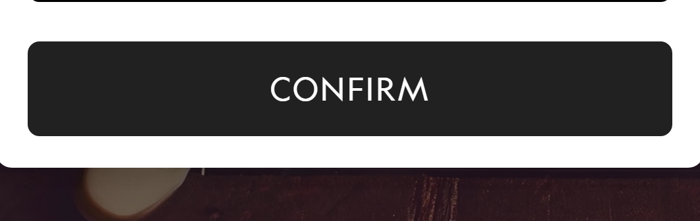

*Self-check:* flagged — The 24.6s lab LCP and 519 requests can't be checked from the screenshots, and the evidence is just the hero H1 text (the crop shows the CONFIRM button), so the claim rests on one emulated visit.

### F3 · No customer reviews, ratings or press proof appear next to the product cards or hero

`social_proof` · absence · severity **high** · skeptical first-timer, comparison shopper, risk-averse evaluator · ⚑ flagged

The page claims 'the world's most comfortable shoe' and 'wildly comfortable' but offers no ratings, review counts or testimonials. Product cards show only name, colour and price. A visitor who doesn't know the brand has nothing to back the claim.

> “Lightweight, bouncy, and wildly comfortable” — `D113` desktop

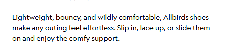

> “the world's most comfortable shoe” — `D157` desktop

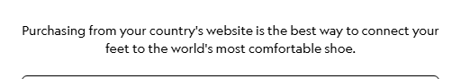

> “$100” — `D38` desktop

*Self-check:* flagged — The text blocks show no ratings or reviews near the hero or product cards, but only the first screen and text list were seen, so reviews may exist in image-based or unlisted widgets, and the cited quotes only show the claims being made.

### F4 · 'FINAL SALE' badges appear on sale products with no explanation of the returns policy, and returns are only a footer link

`trust_risk` · absence · severity **high** · risk-averse evaluator, ready to buy, skeptical first-timer

The discounted items carry a 'FINAL SALE' tag, which signals no returns, and the page doesn't say what that means. For shoes, where fit matters, this is a real purchase risk. No return window or guarantee is shown near the cards or hero.

> “FINAL SALE” — `D63` desktop

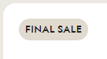

> “Returns/Exchanges” — `D124` desktop

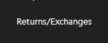

> “FINAL SALE” — `M49` mobile

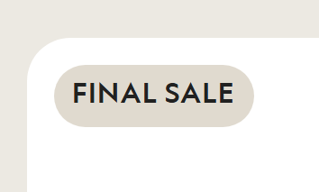

*Self-check:* kept — D63 and M49 show FINAL SALE badges on cards, and the only returns reference is the footer link D124, so the trust-risk reasoning for shoes is specific to this page.

### F5 · The H1 'Our biggest sale. Your comfiest season.' is a slogan that names no product or benefit, and the 70% claim is in a small kicker qualified by 'select styles'

`value_prop_clarity` · issue · severity **medium** · skeptical first-timer, comparison shopper · ⚑ flagged

A first-time visitor sees a sale for an unnamed product. The discount depth sits in a small line above the H1, and the banner limits it to select styles, so the visitor can't tell which products are discounted.

> “Our biggest sale. Your comfiest season.” — `D21` desktop

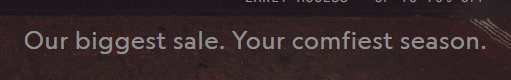

> “EARLY ACCESS · UP TO 70% OFF” — `D20` desktop

*Self-check:* flagged — The H1 is a slogan and the 70% line is a small kicker (visible in the desktop hero), but the page does name the sale and the banner says 'select styles', so how much this hurts is subjective.

### F6 · Hero and tile CTAs are split into repeated SHOP MEN / SHOP WOMEN pairs, and none leads directly to the sale

`cta` · issue · severity **medium** · ready to buy, mobile skimmer, comparison shopper · ⚑ flagged

The hero promises up to 70% off but its buttons are generic Men/Women labels. Further tiles repeat the same pair, so a visitor can't tell which button goes to sale items. Sale-specific links such as 'SHOP WOMEN'S SALE' are only in the menu panel.

> “SHOP MEN” — `D22` desktop

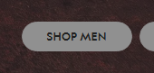

> “SHOP MEN” — `M104` mobile

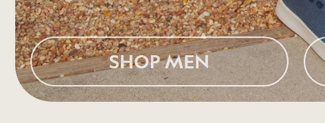

> “SHOP WOMEN'S SALE” — `D18` desktop

*Self-check:* flagged — The hero buttons are plain SHOP MEN and SHOP WOMEN, but the hero is a sale and those buttons likely lead to sale-relevant pages, and whether the sale links sit only in the menu is an assumption.

### F7 · Best Sellers shows mostly full-price items and 30% discounts, which undercuts the 'up to 70% off' hero promise

`offer` · issue · severity **medium** · comparison shopper, ready to buy · ⚑ flagged

The visible discounts are $75 to $52.50 and $105 to $73.50, both 30%. Other cards show $100 or $105 with no discount. A visitor expecting deep savings sees none, and no copy explains which styles reach 70%.

> “$73.50 $105” — `D79` desktop

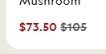

> “$105” — `D44` desktop

> “UP TO 70% OFF” — `D20` desktop

*Self-check:* flagged — D79 and D44 show 30% discounts and full-price items, but 'up to 70%' is not contradicted by 30% items and the best sellers section may not be where the deep discounts sit.

### F8 · The 'Early Access' sale has no end date or deadline in the banner or hero

`offer` · absence · severity **low** · ready to buy, comparison shopper · ⚑ flagged

The sale gives a reason to act, but with no deadline the visitor can postpone the decision. No date, countdown or stock cue appears in the banner or hero.

> “Black Friday Early Access. Up to 70% off select styles.” — `D2` desktop

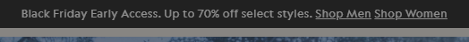

> “EARLY ACCESS · UP TO 70% OFF” — `D20` desktop

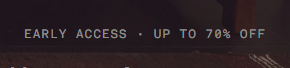

*Self-check:* flagged — D2 and D20 show no deadline text, but the finding is low-impact and the end date may be in unseen terms or elsewhere on the site.

### F9 · The benefit copy ('wildly comfortable', 'better for the planet—win, win, win') is generic and sits near the footer with no product specifics

`specificity` · issue · severity **medium** · comparison shopper, skeptical first-timer · ⚑ flagged

The only explanatory copy is three short paragraphs just above the footer. They have no figures, per-product materials or comparison, so they give a shopper nothing to weigh against rivals.

> “better for the planet—win, win, win” — `D117` desktop

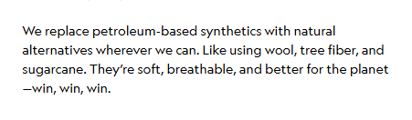

> “Easy-to-wear styles made for daily routines, weekend plans, travel, and everything in between.” — `D115` desktop

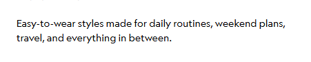

*Self-check:* flagged — D115 and D117 are generic copy near the footer as claimed, but D117 does name wool, tree fiber and sugarcane, and this is a subjective copy critique on a category page where product specifics sit on product pages.

## What this page is (understanding)

| | Inferred | Confidence | Evidence |
|---|---|---|---|
| Audience | Consumer shoppers in the US (men and women) buying comfortable, sustainable casual shoes, socks and apparel for themselves or as holiday gifts, drawn by Black Friday and holiday sale pricing. (inferred) | medium | D2, D21, D22, D23, D157, D1 |
| Job to be done | When I want a comfortable pair of shoes and the holiday sales are on, I want to find a men's or women's style at a big discount quickly, so I can get comfortable shoes (or a gift) without overpaying. | medium | D2, D20, D21, D22, D23, D18, D19 |
| Traffic source | Mostly direct/brand traffic, plus brand search and email or paid retargeting for the Black Friday sale. Signals: full site navigation, a brand-led page title, a country selector and a seasonal sale banner. There is no keyword-led H1 and no single-offer focus. (inferred) | medium | D5, D6, D2, D21, D156 |
| Awareness level | product_aware | medium | D21, D20, D2, D157 |
| Promise | Allbirds makes the world's most comfortable shoe, and the holiday sale is the time to buy it: up to 70% off for a 'comfiest season'. | | D21, D20, D157, D2 |
| Offer | Black Friday early access with up to 70% off select styles, plus free ground shipping on orders over $100. The first screen links to Shop Men and Shop Women. | | D2, D20, D1, D12, D22, D23 |

**5-second test** — clear: no, specific: no. Judged copy: “Our biggest sale. Your comfiest season. | EARLY ACCESS · UP TO 70% OFF | Where are we shipping to? | Purchasing from your country's website is the best way to connect your feet to the world's most comfortable shoe.”. A visitor takes away: A 'Where are we shipping to?' modal covers the screen. Behind it, a shoe brand (Allbirds) shows a couple on a sofa at Christmas, a sale headline and Shop Men/Shop Women buttons. A visitor would see a shipping-country prompt first, then a holiday sale at a shoe brand. The headline is partly dimmed and the product is barely visible. The sale is clear, but what the product is and why it matters is not.

**LIFT** (1 = serious problem, 5 = strong)

| Factor | Score | Reason |
|---|---|---|
| value_proposition | 3 | Sale depth (up to 70%) and a comfort claim exist, but the hero gives no concrete product benefit, and the 'biggest sale' is not backed by visible discounts: most best-seller cards show full price. |
| relevance | 3 | For a visitor arriving for the Black Friday sale, the banner and hero match. But the shipping modal and the generic category tiles do not take them to sale items. |
| clarity | 2 | A country modal covers the hero on both viewports. The H1 is a slogan with no product named. Several identical SHOP MEN / SHOP WOMEN buttons repeat, so the next step is split. |
| anxiety | 2 | No reviews, ratings, return window or guarantee appear on the page. The only returns signal is a footer link, while some items are tagged FINAL SALE with no explanation. |
| distraction | 2 | A blocking modal sits over the hero. Beyond that there are many repeated category CTAs, a carousel of near-identical slip-ons, and a link-heavy footer. |
| urgency | 3 | 'Early Access' and 'Up to 70% off' give a seasonal reason to act, but there is no end date or countdown. |

**Persona walkthroughs**

- **skeptical first-timer** — stalls: `D156` A modal about shipping country is the first thing they see, before they know what the brand sells.; `D21` The slogan names no product, material or reason to believe the 'comfiest' claim.; `D117` The only substantive claims sit far down, and they have no proof, such as reviews or press.. Objections: What exactly is this and is it for me? (partial); Is the brand real and trusted (reviews, ratings)? (absent); Is the 'most comfortable' claim true? (absent).
- **comparison shopper** — stalls: `D113` The copy says 'wildly comfortable' but gives no specifics (materials, cushioning, weight) to compare with rivals.; `D38` Several cards show full price with no discount, so the real deal is unclear.; `D117` Materials are described vaguely ('wool, tree fiber, sugarcane') with no link to specific products.. Objections: How is this different from other comfort shoe brands? (partial); What is the real discount and which styles are included? (partial); Independent reviews or ratings? (absent).
- **ready to buy** — stalls: `D159` They must confirm a country before doing anything.; `D22` The hero CTAs go to broad Men or Women collections, not to the sale items.; `D39` QUICK ADD on a card shows no size information on desktop, so it is unclear what happens on click.. Objections: Shipping cost and threshold (answered); Returns on sale items (partial); Sale end date (absent).
- **mobile skimmer** — stalls: `M136` The modal fills most of the first mobile screen and hides the hero headline.; `M19` After dismissal, they meet a stack of repeated Shop Men/Shop Women pairs.; `M106` The page is long, with image-led tiles before any benefit text appears.. Objections: Will the page load fast? (absent); Is the first screen clear? (absent).
- **risk-averse evaluator** — stalls: `D124` Returns information is only a footer link, with no stated window or terms.; `D63` 'FINAL SALE' implies no returns but nothing explains the policy.; `D149` Refund, privacy and shipping policies are footer links only, not shown at decision points.. Objections: Return or refund policy (partial); Legitimacy of the company (partial); Data handling (partial).

## Assumptions and couldn't verify

- **Traffic source** — No source was given, and none can be seen from the page. Assumed: Mostly direct, brand search and email/retargeting traffic for the Black Friday sale.
- **Real page speed** — The lab numbers come from one local visit with mobile emulation. The 24.6 s LCP may be inflated by the capture environment. Assumed: Real users see a faster but still heavy page, given 519 requests.
- **Content after the last mobile tile** — The mobile screenshots stop at y=3376 of 4447px. Assumed: The remainder is the footer, as on desktop.
- **Product pages, checkout and Final Sale policy** — They sit behind links and were not captured. Assumed: Reviews and the returns policy may appear on product pages but not on this page.
- **Hidden menu and cart content** — The cart and menu text exists in the DOM but is not visible in the screenshots. Assumed: Both are closed by default and reachable only by interaction.
- **Whether the modal appears for all visitors** — It may depend on geolocation or cookies and may not show to returning visitors. Assumed: It shows to first-time visitors, as captured.
- **Bottom of the mobile page** — only 4 screenshot tiles were shown to the model.

## Dropped by self-check

_Nothing was dropped._

## Page speed

lab: one local Playwright visit (mobile emulation).

| TTFB | DOMContentLoaded | Load | LCP | CLS | Requests | Transfer (≥) |
|---|---|---|---|---|---|---|
| 198 ms | 1244 ms | 2475 ms | 24592 ms | 0.0 | 519 | 5254 KB |

## Run

- Run `20261110-210614-www-allbirds-com` · provider `claude-code` · model `sonnet`
- 2026-11-10T18:06:15+00:00 → 2026-11-10T18:10:28+00:00; 4 model calls, 190 s of model time
- Cost: $0.510 API-equivalent (billed to your Claude subscription, not metered)
