# Landing page teardown — Meeting Scheduling Software and AI Meeting Tools | Calendly

`https://calendly.com/` · 2026-11-10 · model `sonnet`

## Summary

The page is for product-aware professionals who run on client meetings (sales, consultants, recruiters, freelancers), mostly arriving by brand or direct search and signing up free with Google or Microsoft. The biggest problems are that the hero H1 "All the work around meetings, handled." is vague, and that customer proof sits about seven screens below the sign-up buttons and is missing on the mobile capture. The free plan's scope and paid pricing are also unclear next to "No credit card required". Test first the hero headline (F1), the proof strip near the hero buttons (F2) and the free-plan line (F4); all three target the same hero sign-up click-through, so run them one after another or as a factorial test to keep results clean. F3, F5 and F6 are flagged, subjective or secondary, so test them later.

## Top 3 experiments

### 1. Customer proof only appears at the bottom of the page (y≈7200+ on desktop), and nothing sits near the hero sign-up buttons

*Why first:* Highest impact with the strongest evidence (a kept finding): proof is about seven screens below the hero ask and absent on mobile; the testimonials already exist, so effort is moderate.

**X2 · ICE 6.0** (I 7 · C 5 · E 6)  
If we add a proof strip directly under the hero sign-up buttons (a short customer quote and customer-count or logo row, replacing nothing above the fold), then hero sign-up click-through will increase for skeptical first-timers, risk-averse evaluators and mobile skimmers, because the first proof ("Real customers. Real results.") sits about seven screens down and the mobile capture shows none near "No credit card required".  
Change: *Hero ends with "No credit card required"; first customer proof appears at "Real customers. Real results." near the bottom of the page.* → *Hero shows one real customer quote with name, role and company, plus a verified customer logo row or count taken from existing company data, directly beneath the sign-up buttons on desktop and mobile.*  
Primary metric: hero sign-up click-through · guardrail: bounce rate · feasibility: `ab_ok`  
Why these scores — impact: Puts proof at the point of decision for three personas; the evidence says the gap is real and verified.; confidence: base 3; +1 evidence verified and kept by self-check; +1 raised for 2+ personas; capped at 6: no traffic data; ease: Needs a hero layout change and design on desktop and mobile; the testimonials already exist, but logos or counts must be sourced and approved.

### 2. The H1 'All the work around meetings, handled.' does not say what the product does or who it is for

*Why first:* A kept finding and a copy-only change in the CMS, so it is the cheapest test with a clear mechanism on the main hero decision.

**X1 · ICE 6.67** (I 6 · C 5 · E 9)  
If we change the hero H1 "All the work around meetings, handled." to a specific outcome headline naming scheduling, AI notes and follow-ups, then hero sign-up click-through will increase for skeptical first-timers and comparison shoppers, because the current H1 and its subhead ("get the busywork done with fewer tools and less effort") never say what the product does or who it is for, so visitors must read the tabs to find out.  
Change: *H1: "All the work around meetings, handled." / Subhead: "From AI-powered scheduling to automated meeting recaps and follow-ups, get the busywork done with fewer tools and less effort."* → *H1 names the three jobs (schedule, record, follow up) and the audience; subhead states the outcome in plain words without 'busywork' or 'less effort'.*  
Suggested copy: “H1: Schedule it. Record it. Follow up on it. All in one place.
Subhead: Calendly books your meetings, takes the notes and sends the follow-ups, so you stop chasing people over email and start spending your time with clients.”  
Primary metric: hero sign-up click-through (Google, Microsoft and email buttons combined) · guardrail: sign-up completion rate (activated accounts per click) · feasibility: `ab_ok`  
Why these scores — impact: Removes a real clarity doubt for half-aware visitors, but the brand is well known so the main persona may already understand it.; confidence: base 3; +1 evidence verified and kept by self-check; +1 raised for 2+ personas; capped at 6: no traffic data; ease: Hero headline and subhead copy swap in the CMS.

### 3. The hero says 'No credit card required' but never says what the free plan includes or where paid plans start

*Why first:* Pricing uncertainty affects comparison shoppers and buyers. The evidence is flagged rather than kept, but the test is a one-line change once the team decides what to show about the free plan.

**X3 · ICE 5.67** (I 6 · C 4 · E 7) ⚑ flagged by self-check  
If we change "Sign up with email • No credit card required" to a line that states what the free plan includes and where paid plans start, with a link to Pricing, then hero sign-up click-through will increase for comparison shoppers, ready-to-buy visitors and risk-averse evaluators, because the page promotes Payments, Notetaker and Callie without saying which are free, leaving a possible paywall surprise.  
Change: *"Sign up with email • No credit card required"* → *A one-line free-plan summary under the buttons plus a "See what's free" link to Pricing.*  
Suggested copy: “Free plan: [what the team confirms is included, e.g. unlimited scheduling links]. Paid plans from [price]/month. No credit card required. See plans”  
Primary metric: hero sign-up click-through · guardrail: paid plan conversion rate within the trial period · feasibility: `ab_ok`  
Why these scores — impact: Removes a real doubt for comparison shoppers and buyers, but the review flagged it as partly mitigated by the Pricing nav link.; confidence: base 3; +1 raised for 2+ personas; capped at 6: no traffic data; ease: Copy is quick, but the exact free-plan scope and price to show need a product or pricing decision first; bracketed text is a placeholder.

## Experiment backlog

| # | Hypothesis | Metric | I | C | E | ICE | Feasibility | Flag |
|---|---|---|---|---|---|---|---|---|
| X1 | If we change the hero H1 "All the work around meetings, handled." to a specific outcome headline naming scheduling, AI notes and follow-ups, then hero sign-up click-through will increase for skeptical first-timers and comparison shoppers, because the current H1 and its subhead ("get the busywork done with fewer tools and less effort") never say what the product does or who it is for, so visitors must read the tabs to find out. | hero sign-up click-through (Google, Microsoft and email buttons combined) | 6 | 5 | 9 | **6.67** | ab_ok |  |
| X2 | If we add a proof strip directly under the hero sign-up buttons (a short customer quote and customer-count or logo row, replacing nothing above the fold), then hero sign-up click-through will increase for skeptical first-timers, risk-averse evaluators and mobile skimmers, because the first proof ("Real customers. Real results.") sits about seven screens down and the mobile capture shows none near "No credit card required". | hero sign-up click-through | 7 | 5 | 6 | **6.0** | ab_ok |  |
| X3 | If we change "Sign up with email • No credit card required" to a line that states what the free plan includes and where paid plans start, with a link to Pricing, then hero sign-up click-through will increase for comparison shoppers, ready-to-buy visitors and risk-averse evaluators, because the page promotes Payments, Notetaker and Callie without saying which are free, leaving a possible paywall surprise. | hero sign-up click-through | 6 | 4 | 7 | **5.67** | ab_ok | ⚑ |
| X4 | If we add a short trust line with a link to the privacy and security page next to the "Sign up with Google" and Microsoft buttons, then hero sign-up click-through on the OAuth buttons will increase for risk-averse evaluators, because sign-up means granting calendar access and Callie and Notetaker handle email and meetings, yet no privacy statement appears next to them. | hero OAuth sign-up click-through | 4 | 4 | 8 | **5.33** | qualitative_only | ⚑ |
| X5 | If we change "Book meetings with the world’s #1 scheduling tool" and "Calendly is the easiest and most powerful way to find time to connect." to claims backed by a concrete, sourced number, then sign-up click-through will increase for comparison shoppers, because an unsourced superlative invites doubt while concrete figures like "150+ integrations" are more credible. | click-through on the section's sign-up CTA | 3 | 4 | 8 | **5.0** | bold_change_only | ⚑ |
| X6 | If we change the hero so the email sign-up is a full-width equal button and the product carousel moves below a single clear CTA group, then hero sign-up click-through will increase for ready-to-buy visitors and mobile skimmers, because the hero currently shows two large OAuth buttons, a small underlined "Sign up with email" link and "Learn more" links that pull attention away from one action. | hero sign-up click-through | 4 | 5 | 6 | **5.0** | bold_change_only | ⚑ |

Confidence is computed, not guessed: base 3, +1 evidence kept by the self-check, +1 matches a weak LIFT factor, +1 raised by two or more personas; capped at 6 because the tool has no traffic data.

**X1 · ICE 6.67** (I 6 · C 5 · E 9)  
If we change the hero H1 "All the work around meetings, handled." to a specific outcome headline naming scheduling, AI notes and follow-ups, then hero sign-up click-through will increase for skeptical first-timers and comparison shoppers, because the current H1 and its subhead ("get the busywork done with fewer tools and less effort") never say what the product does or who it is for, so visitors must read the tabs to find out.  
Finding F1: The H1 'All the work around meetings, handled.' does not say what the product does or who it is for  
Change: *H1: "All the work around meetings, handled." / Subhead: "From AI-powered scheduling to automated meeting recaps and follow-ups, get the busywork done with fewer tools and less effort."* → *H1 names the three jobs (schedule, record, follow up) and the audience; subhead states the outcome in plain words without 'busywork' or 'less effort'.*  
Suggested copy: “H1: Schedule it. Record it. Follow up on it. All in one place.
Subhead: Calendly books your meetings, takes the notes and sends the follow-ups, so you stop chasing people over email and start spending your time with clients.”  
Primary metric: hero sign-up click-through (Google, Microsoft and email buttons combined) · guardrail: sign-up completion rate (activated accounts per click) · feasibility: `ab_ok`  
Why these scores — impact: Removes a real clarity doubt for half-aware visitors, but the brand is well known so the main persona may already understand it.; confidence: base 3; +1 evidence verified and kept by self-check; +1 raised for 2+ personas; capped at 6: no traffic data; ease: Hero headline and subhead copy swap in the CMS.

**X2 · ICE 6.0** (I 7 · C 5 · E 6)  
If we add a proof strip directly under the hero sign-up buttons (a short customer quote and customer-count or logo row, replacing nothing above the fold), then hero sign-up click-through will increase for skeptical first-timers, risk-averse evaluators and mobile skimmers, because the first proof ("Real customers. Real results.") sits about seven screens down and the mobile capture shows none near "No credit card required".  
Finding F2: Customer proof only appears at the bottom of the page (y≈7200+ on desktop), and nothing sits near the hero sign-up buttons  
Change: *Hero ends with "No credit card required"; first customer proof appears at "Real customers. Real results." near the bottom of the page.* → *Hero shows one real customer quote with name, role and company, plus a verified customer logo row or count taken from existing company data, directly beneath the sign-up buttons on desktop and mobile.*  
Primary metric: hero sign-up click-through · guardrail: bounce rate · feasibility: `ab_ok`  
Why these scores — impact: Puts proof at the point of decision for three personas; the evidence says the gap is real and verified.; confidence: base 3; +1 evidence verified and kept by self-check; +1 raised for 2+ personas; capped at 6: no traffic data; ease: Needs a hero layout change and design on desktop and mobile; the testimonials already exist, but logos or counts must be sourced and approved.

**X3 · ICE 5.67** (I 6 · C 4 · E 7) ⚑ flagged by self-check  
If we change "Sign up with email • No credit card required" to a line that states what the free plan includes and where paid plans start, with a link to Pricing, then hero sign-up click-through will increase for comparison shoppers, ready-to-buy visitors and risk-averse evaluators, because the page promotes Payments, Notetaker and Callie without saying which are free, leaving a possible paywall surprise.  
Finding F4: The hero says 'No credit card required' but never says what the free plan includes or where paid plans start  
Change: *"Sign up with email • No credit card required"* → *A one-line free-plan summary under the buttons plus a "See what's free" link to Pricing.*  
Suggested copy: “Free plan: [what the team confirms is included, e.g. unlimited scheduling links]. Paid plans from [price]/month. No credit card required. See plans”  
Primary metric: hero sign-up click-through · guardrail: paid plan conversion rate within the trial period · feasibility: `ab_ok`  
Why these scores — impact: Removes a real doubt for comparison shoppers and buyers, but the review flagged it as partly mitigated by the Pricing nav link.; confidence: base 3; +1 raised for 2+ personas; capped at 6: no traffic data; ease: Copy is quick, but the exact free-plan scope and price to show need a product or pricing decision first; bracketed text is a placeholder.

**X4 · ICE 5.33** (I 4 · C 4 · E 8) ⚑ flagged by self-check  
If we add a short trust line with a link to the privacy and security page next to the "Sign up with Google" and Microsoft buttons, then hero sign-up click-through on the OAuth buttons will increase for risk-averse evaluators, because sign-up means granting calendar access and Callie and Notetaker handle email and meetings, yet no privacy statement appears next to them.  
Finding F5: No security, privacy or data-handling statement sits near the sign-up buttons or the AI/recording features  
Change: *Sign-up buttons with only "No credit card required" below them; no data-handling statement near the buttons or the AI features.* → *A trust line under the buttons that says what access is requested and links to the privacy and security page.*  
Suggested copy: “We only use your calendar to find times and never share your data. Read how we protect it”  
Primary metric: hero OAuth sign-up click-through · guardrail: bounce rate · feasibility: `qualitative_only`  
Why these scores — impact: Matters mainly to a secondary, risk-averse group; the concern is plausible but assumed, not shown by the evidence.; confidence: base 3; +1 raised for 2+ personas; capped at 6: no traffic data; ease: Single line of copy and a link in the hero; the claim wording needs legal or security approval first.

**X5 · ICE 5.0** (I 3 · C 4 · E 8) ⚑ flagged by self-check  
If we change "Book meetings with the world’s #1 scheduling tool" and "Calendly is the easiest and most powerful way to find time to connect." to claims backed by a concrete, sourced number, then sign-up click-through will increase for comparison shoppers, because an unsourced superlative invites doubt while concrete figures like "150+ integrations" are more credible.  
Finding F3: The claim 'world's #1 scheduling tool' has no source or metric attached  
Change: *"Book meetings with the world’s #1 scheduling tool" and "Calendly is the easiest and most powerful way to find time to connect."* → *Headline and supporting line using a verifiable fact (customer count, integrations, or a named review-site rating) with its source linked.*  
Suggested copy: “Book meetings with the scheduling tool that connects to 150+ apps you already use.
Rated [X]/5 by [N] users on [review site, with link].”  
Primary metric: click-through on the section's sign-up CTA · guardrail: bounce rate · feasibility: `bold_change_only`  
Why these scores — impact: The review flagged this as minor and subjective; the brand is well known so the doubt is small and a copy change in one section is unlikely to move sign-ups.; confidence: base 3; +1 raised for 2+ personas; capped at 6: no traffic data; ease: Copy change, but the real figures (rating, counts) must be confirmed by the team before use; placeholders in brackets must be replaced.

**X6 · ICE 5.0** (I 4 · C 5 · E 6) ⚑ flagged by self-check  
If we change the hero so the email sign-up is a full-width equal button and the product carousel moves below a single clear CTA group, then hero sign-up click-through will increase for ready-to-buy visitors and mobile skimmers, because the hero currently shows two large OAuth buttons, a small underlined "Sign up with email" link and "Learn more" links that pull attention away from one action.  
Finding F6: The hero offers three sign-up routes, a nav CTA, a four-tab carousel and a 'Learn more' link, which split attention from one action  
Change: *Two large OAuth buttons, a small underlined "Sign up with email" link, and a four-tab carousel with "Learn more" links directly beneath.* → *One CTA group with three equal-weight sign-up options, with the carousel pushed below the fold and its "Learn more" links demoted.*  
Primary metric: hero sign-up click-through · guardrail: scroll depth to the product sections · feasibility: `bold_change_only`  
Why these scores — impact: The attention-split claim is subjective since carousels are a standard pattern; it may help ready-to-buy visitors but the effect is probably small.; confidence: base 3; +1 matches weak LIFT factor (distraction); +1 raised for 2+ personas; capped at 6: no traffic data; ease: Layout change in the hero needing design and front-end work on desktop and mobile.

## Findings

### F1 · The H1 'All the work around meetings, handled.' does not say what the product does or who it is for

`value_prop_clarity` · issue · severity **medium** · skeptical first-timer, comparison shopper

Visitors who only half know the brand have to read the subhead and click through the product tabs to learn it is a scheduler plus AI notes and payments. The headline says 'handled' without naming the outcome (fewer back-and-forth emails, fewer no-shows). The subhead's 'busywork' and 'less effort' are also unquantified.

> “All the work around meetings, handled.” — `D10` desktop

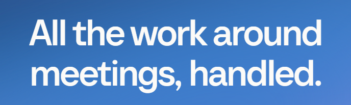

> “get the busywork done with fewer tools and less effort.” — `D11` desktop

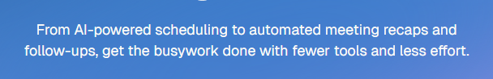

*Self-check:* kept — The H1 'All the work around meetings, handled.' in the hero is indeed vague about what the product is, and the subhead only partly clarifies it with product names via carousel tabs.

### F2 · Customer proof only appears at the bottom of the page (y≈7200+ on desktop), and nothing sits near the hero sign-up buttons

`social_proof` · issue · severity **high** · skeptical first-timer, risk-averse evaluator, mobile skimmer

The decision to sign up is asked for in the hero, but the first testimonials come after about seven screens. The mobile capture, covering only the first 3,376px of 18,799px, shows no proof at all. The captured proof is also mostly small founders and offers no verifiable logos or counts.

> “No credit card required” — `D14` desktop

> “Real customers. Real results.” — `D118` desktop

> “No credit card required” — `M9` mobile

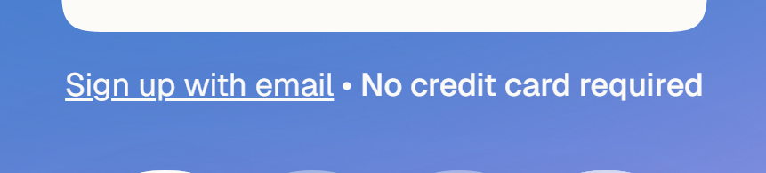

*Self-check:* kept — The first-screen hero has only 'No credit card required' near the sign-up buttons, and the testimonials (D118 at y≈7230) are far below; the claim is true of the page.

### F3 · The claim 'world's #1 scheduling tool' has no source or metric attached

`specificity` · issue · severity **medium** · comparison shopper, skeptical first-timer · ⚑ flagged

A superlative with no source invites doubt from visitors comparing alternatives. The same block's 'easiest and most powerful' is also unsupported. Only '150+ other integrations' (D75) is concrete, and it is hidden in an accordion.

> “Book meetings with the world’s #1 scheduling tool” — `D23` desktop

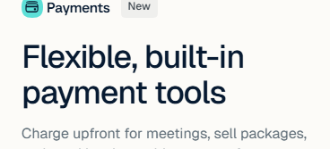

> “Calendly is the easiest and most powerful way to find time to connect.” — `D24` desktop

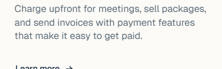

*Self-check:* flagged — The 'world's #1' claim (D23) is real and unsourced, but the crops shown are of the Payments tab, not this text, and the brand is well known so the impact is subjective and minor; also the '150+' claim is not hidden in an accordion as asserted.

### F4 · The hero says 'No credit card required' but never says what the free plan includes or where paid plans start

`pricing_visibility` · absence · severity **high** · comparison shopper, ready to buy, risk-averse evaluator · ⚑ flagged

The page pushes Payments, Notetaker and Callie, yet nothing on the captured page says which of these are free. Visitors have to open the Pricing nav link to find out. The risk of a surprise paywall after sign-up remains.

> “Sign up with email • No credit card required” — `D14` desktop

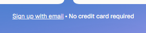

> “Pricing” — `D6` desktop

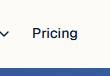

*Self-check:* flagged — No plan details appear in the hero, but 'Pricing' is in the nav (D6) and 'No credit card required' is present, so the gap is partly mitigated and the surprise-paywall risk is an assumption.

### F5 · No security, privacy or data-handling statement sits near the sign-up buttons or the AI/recording features

`trust_risk` · absence · severity **medium** · risk-averse evaluator, skeptical first-timer · ⚑ flagged

Google/Microsoft sign-up means granting calendar access. Callie reads email threads and Notetaker joins calls, which raises data and consent concerns. The captured page offers no badge, policy link or explanation next to them.

> “Sign up with Google” — `D12` desktop

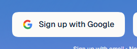

> “just add callie@calendly.com to the email thread” — `D85` desktop

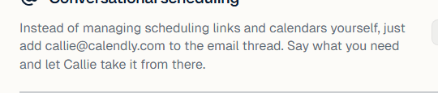

> “Notetaker joins and takes notes” — `M52` mobile

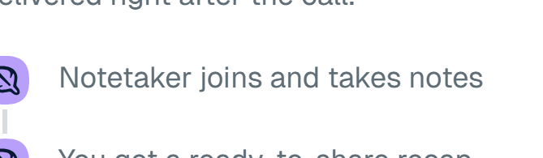

*Self-check:* flagged — No security statement is visible near the sign-up buttons or the AI features, but the footer has Privacy Policy and the page capture can't confirm what happens on OAuth consent, so the concern is plausible but assumed.

### F6 · The hero offers three sign-up routes, a nav CTA, a four-tab carousel and a 'Learn more' link, which split attention from one action

`visual_hierarchy_distraction` · issue · severity **medium** · ready to buy, mobile skimmer · ⚑ flagged

Directly under the buttons, a product carousel with different H2s and 'Learn more' links invites exploration. The plain email option is a small underlined link under two large OAuth buttons. The long page repeats the same four products in two further sections, each with more links.

> “Sign up with email” — `D15` desktop

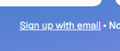

> “Learn more” — `D25` desktop

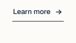

> “Open Full control over your calendar” — `D64` desktop

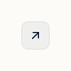

*Self-check:* flagged — The hero does show two large OAuth buttons, a small email link and a carousel with Learn more links, but the carousel is a standard pattern, and the evidence D64 is an unrelated lower-page arrow icon, so the attention-split claim is subjective.

## What this page is (understanding)

| | Inferred | Confidence | Evidence |
|---|---|---|---|
| Audience | Individual professionals and small-to-mid teams whose work runs on meetings (client-facing roles such as sales, consultants, recruiters, coaches, freelancers) who schedule with outside people and also want AI notes, follow-ups and payments. Sign-up via Google/Microsoft suggests Workspace/M365 users. (inferred) | medium | D42, D43, D12, D13, M37, M41 |
| Job to be done | When I have to book, prepare for, capture and follow up on meetings with clients or colleagues, I want the scheduling, recap and follow-up busywork handled for me, so I can spend my time on the work that matters instead of juggling tools. | medium | D10, D11, D43, D29, D34, M41 |
| Traffic source | Mostly direct/brand and branded organic search: the homepage has full site navigation, a Log In link, brand-first copy and a product-suite carousel. Page title is keyword-rich ('Meeting Scheduling Software'), so non-branded organic search adds a share. It is not a single-offer paid landing page. (inferred) | medium | D2, D3, D8, D10, D23 |
| Awareness level | product_aware | medium | D10, D23, D24, D28, D8, D12 |
| Promise | Calendly takes over the work around meetings (scheduling, recaps, follow-ups, payments) with AI and fewer tools, so you get the busywork done with less effort. | | D10, D11, D43 |
| Offer | Free sign-up with no credit card required, via Google, Microsoft or email. There is also a 'Get started for free' button in the nav and a 'Talk to sales' option. | | D12, D13, D14, D9, D7, D44 |

**5-second test** — clear: yes, specific: no. Judged copy: “All the work around meetings, handled. — From AI-powered scheduling to automated meeting recaps and follow-ups, get the busywork done with fewer tools and less effort.”. A visitor takes away: Calendly is a tool that handles meeting-related tasks with AI. It covers scheduling, recaps and follow-ups, and you can sign up free with Google or Microsoft. The headline alone is vague about what the product does. The subhead and the product tabs (Scheduling, Callie, Notetaker, Payments) fill that in. The target user is not named.

**LIFT** (1 = serious problem, 5 = strong)

| Factor | Score | Reason |
|---|---|---|
| value_proposition | 3 | Free sign-up and a broad suite (scheduling, AI recaps, payments) are worth it, but the H1 is abstract and the benefit is not quantified in the hero. |
| relevance | 4 | Product-aware visitors (likely brand or direct) get a brand-first hero and a Google/Microsoft sign-up that fits Workspace/M365 users. The hero now leads with AI and a suite, not the classic scheduling link people may expect. |
| clarity | 3 | The next step is clear (sign up), but the H1 is vague. The carousel swaps four different H2s and the page has two overlapping feature sections for the same products. |
| anxiety | 3 | 'No credit card required' helps. Pricing, plan limits, security/privacy (calendar and meeting recording access) and the free-plan scope are not addressed in the captured part. Beta/New labels add maturity doubts. |
| distraction | 2 | The hero offers three sign-up routes plus nav CTAs. Below it sits a product carousel, four tabs, accordions and many 'Learn more' links. Each leads away from sign-up. |
| urgency | 1 | No time-bound or situational reason to act now. Only an implicit 'free' pull. |

**Persona walkthroughs**

- **skeptical first-timer** — stalls: `D10` The headline does not say what the product is or who it is for.; `D27` Callie is labelled Beta, so the lead AI feature reads as unfinished.; `D120` Proof is far down the page (y≈7200+) and mostly from small-business founders. The results are not shown with context.. Objections: What is this and who is it for? (partial); Is it real and trusted by others? (partial); Is the AI reliable? (absent).
- **comparison shopper** — stalls: `D23` 'World's #1 scheduling tool' is a claim with no source, date or metric.; `D6` Pricing is only a nav link and nothing on the page shows what is free vs paid.; `D75` '150+ other integrations' is the only concrete differentiator, buried in an accordion.. Objections: How does it differ from other schedulers? (partial); What does it cost beyond free? (absent); Which integrations are supported? (partial).
- **ready to buy** — stalls: `D12` Sign-up is OAuth-first. The plain email option is a small underlined link and the Google/Microsoft permissions are unexplained.; `D14` 'No credit card required' does not say which plan or limits apply after sign-up.. Objections: What happens after I click? (absent); Which plan do I get? (absent); Is there a fast path to sign up? (answered).
- **mobile skimmer** — stalls: `M15` The product tab icons are small, and tab content swaps in and out; the tab icon labels are not visible.; `M1` The chat bubble floats over the hero card, next to the tab content.; `M38` The page is long (18,799px), with a text-heavy copy block before the second CTA.. Objections: Can I sign up quickly on my phone? (answered); How far do I have to scroll to see proof? (absent).
- **risk-averse evaluator** — stalls: `D14` Only 'No credit card required' is offered. There are no security, compliance, data handling or cancellation signals.; `D85` Callie and Notetaker handle email threads and meeting recordings, but no privacy or consent explanation is visible.; `D131` The testimonial gives a named company, but the claim is a generic quote with no figure to defend internally.. Objections: How is meeting and calendar data handled? (absent); Security and compliance (SOC 2, GDPR)? (absent); Can I cancel or downgrade? (absent); Is the company legitimate? (partial).

## Assumptions and couldn't verify

- **Traffic source** — None was supplied. Assumed: Mostly direct/brand and branded organic visitors who are product-aware.
- **Pricing and free-plan limits** — Pricing is behind the nav link and was not captured. Assumed: A free plan exists with limits, and some features (Payments, Notetaker) may need paid tiers.
- **What happens after clicking Google/Microsoft/email sign-up** — The flow is not part of the capture. Assumed: A standard OAuth consent followed by onboarding. Permissions and plan are not shown beforehand.
- **Content below the capture** — Desktop stops at y=8100 of 11306 and mobile at y=3376 of 18799, so footer, FAQ, security or logo bars may exist. Assumed: Security/trust and extra proof may exist further down, but not near the hero CTA.
- **Testimonial carousel content and A/B variants** — Only one slide of the carousel was visible, and tab and variant states were not tested. Assumed: The carousel shows similar small-business stories.
- **Real-user speed** — One local lab visit with mobile emulation (LCP 724 ms, CLS 0.0015). Assumed: Speed is not a conversion problem; real-world data may differ.
- **Consent banner effect** — The banner was present but dismissed before capture. Assumed: It did not block the hero for real visitors beyond a brief interruption.
- **Bottom of the desktop page** — only 6 screenshot tiles were shown to the model.
- **Bottom of the mobile page** — only 4 screenshot tiles were shown to the model.

## Dropped by self-check

- **F7 · The hero promises an AI suite, but the first tab headline sells 'scheduling tool' and the Callie tab is labelled Beta** (`message_match`) — The hero screenshot shows the default tab is Callie ('Introducing your 24/7 AI scheduling assistant'), not the classic scheduler, so the claim that the first tab reverts to the scheduler claim is contradicted.
- **F8 · No time-based or situational reason to sign up now appears next to the 'Start for free' CTA** (`offer`) — A generic 'add urgency' suggestion for a brand-aware audience, as the finding itself concedes, and 'Start for free' (D44) next to 'No credit card required' in the hero already lowers the barrier, so it isn't tied to a real page problem.

## Page speed

lab: one local Playwright visit (mobile emulation).

| TTFB | DOMContentLoaded | Load | LCP | CLS | Requests | Transfer (≥) |
|---|---|---|---|---|---|---|
| 292 ms | 1100 ms | 1967 ms | 724 ms | 0.0015 | 227 | 4925 KB |

## Run

- Run `20261110-210614-calendly-com` · provider `claude-code` · model `sonnet`
- 2026-11-10T18:06:14+00:00 → 2026-11-10T18:10:23+00:00; 4 model calls, 148 s of model time
- Cost: $0.410 API-equivalent (billed to your Claude subscription, not metered)
